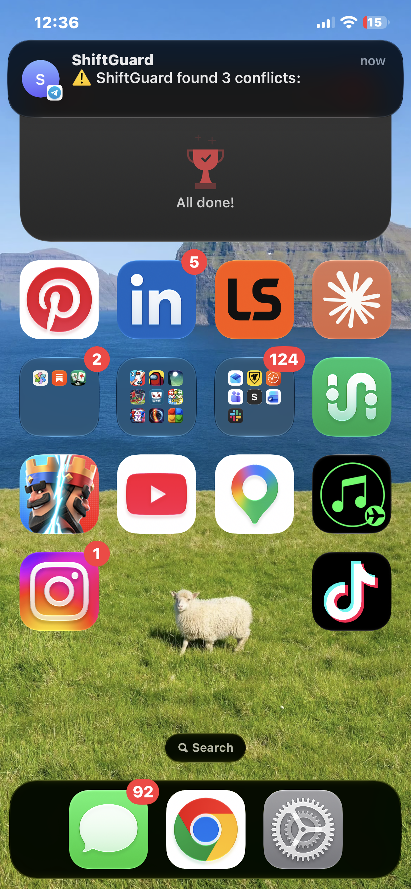
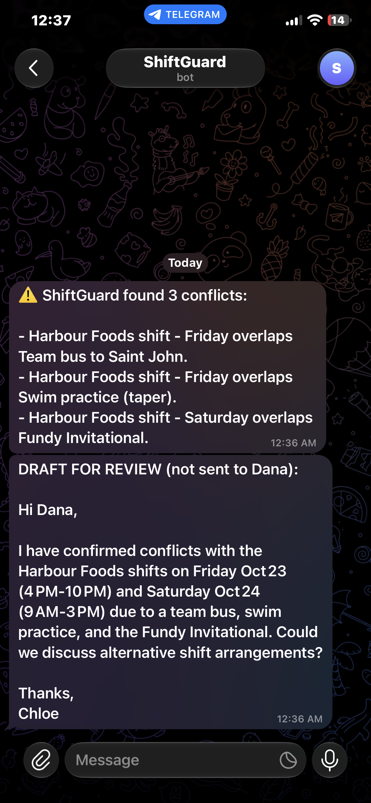

# ShiftGuard Showcase

**ShiftGuard** helps student athletes catch work shifts that clash with training, travel, or competition before the conflict becomes a last-minute problem.

[View the project on GitHub](https://github.com/fouadbuilds/ShiftGuard)

## Watch the demo

[Watch the short screen-recorded demo](demo/screen.mp4)

The recording shows ShiftGuard sending Chloe a Telegram alert, then a single review-only draft that covers every confirmed conflict.

## See it working

### Conflict alert

### Review-only manager draft

## What it does

- Checks fictional work shifts against Chloe's protected swim commitments.
- Adds a 30-minute buffer for travel and warm-up time.
- Sends a Telegram alert listing every detected conflict.
- Uses Groq to create one concise draft for Chloe to review before she contacts her manager.

## What it does not do

- Send a message to Dana.
- Change, cancel, or accept a shift.
- Find a replacement worker.
- Invent facts that are not in the schedule.

The scheduling decision is deterministic code. The AI only turns confirmed conflict facts into a clear, reviewable message.

## Built with

Python, Groq, Telegram, `uv`, and buffer-aware conflict detection.
